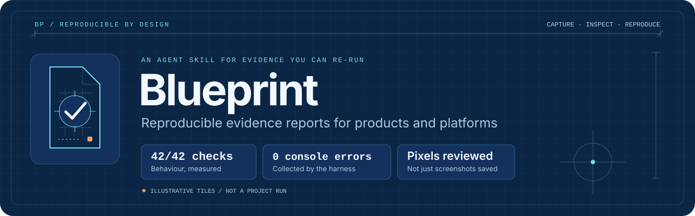
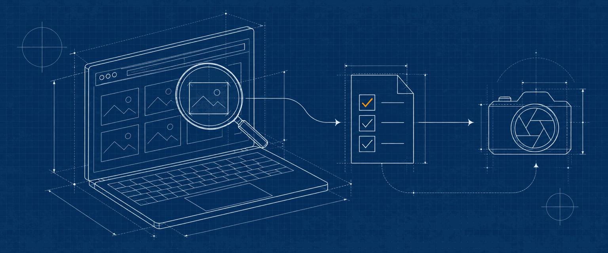
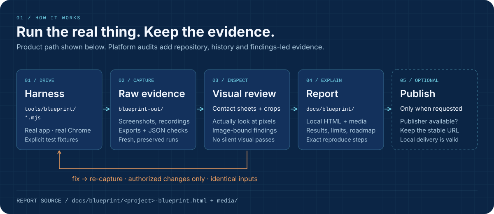
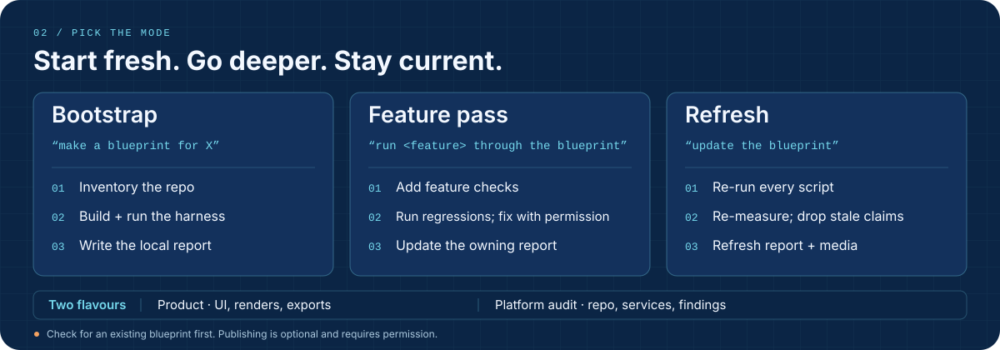
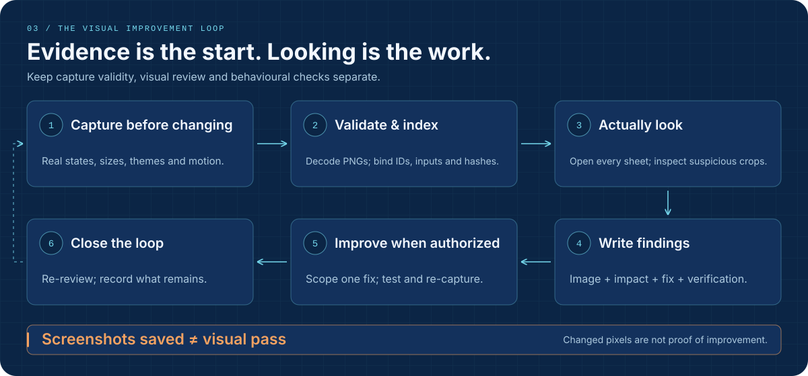
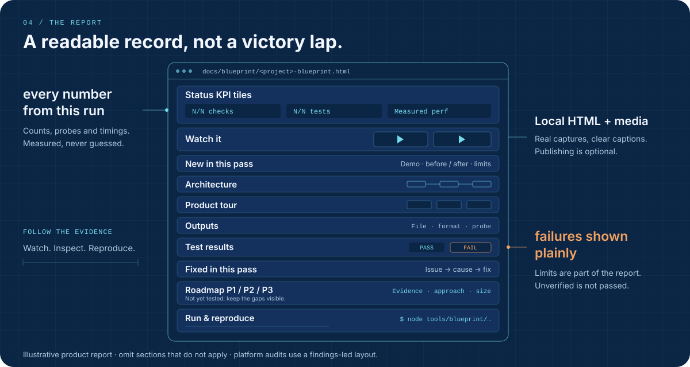

<p align="center">
  
</p>

<p align="center">
  Turn real runs into evidence-backed reports that your repo can regenerate.
</p>

<p align="center">
  <a href="LICENSE"></a>
  
  
  
  
</p>

## What it is

<p align="center">
  
</p>

Blueprint is an agent skill for building two things together: a **reproducible harness** in your project and a **readable evidence report**. The harness captures real screenshots, recordings, exports, checks and measurements. The report explains what works, what failed, what changed and what to do next.

It supports two flavours, which can be mixed:

- **Product:** drive the real app in Chrome; inspect UI states, rendered outputs, exports, performance and edge cases.
- **Platform audit:** inspect the repository and its history; trace risky paths and build a findings ledger with severity, effort, evidence and concrete fixes.

This repository supplies instructions, templates and Python helpers. It is not a ready-made test suite for every app: your agent adapts the harness and report to your project.

### Why

> A blueprint that only shows green is an advert.

Passing checks do not prove the UI looks right. Saved screenshots do not prove anyone inspected them. Blueprint keeps behavioural checks, capture validity and visual review separate, and makes failures and untested areas part of the report.



Every number and claim in the report must come from the latest run. The artwork in this README is illustrative, not evidence from a product run.

## Install

### Claude Code

```sh
git clone https://github.com/DevvGwardo/blueprint-skill ~/.claude/skills/blueprint
```

### Hermes Agent

```sh
git clone https://github.com/DevvGwardo/blueprint-skill ~/.hermes/skills/blueprint
```

Load it with `skill_view("blueprint")`. Use the agent's terminal, file-reading and image-reading tools for the workflow.

### Other agents

Give the agent [SKILL.md](SKILL.md) as its instructions. Resolve `scripts/`, `templates/` and `references/` relative to this skill's installed directory, not the project being audited.

### Prerequisites

| Need | Used for |
|---|---|
| Node.js 18+, the project's Playwright dependency, and Chrome | Browser harness scripts, using `chromium.launch({ channel: "chrome" })`. Use an isolated test profile/context and explicit fixtures. |
| Python 3.10+ and Pillow | Media helpers, image validation, galleries and comparisons. Install Pillow in your Python environment with `python3 -m pip install Pillow`. |
| ffmpeg, optional | `media.py strip` and `media.py mp4`; external video probes may also use ffprobe. |
| `agy` CLI, optional | Explicitly opted-in, model-based image review. Manual/image-capable-agent review is also supported. |

Use your project's existing dependency setup for Playwright. Native desktop evidence needs an exact-window screenshot driver on the host; browser captures cannot prove a separate native window rendered.

**Permission boundaries:** capture-only work does not authorize product edits, uploads, publishing, account actions or clearing a user's state. `--reviewer agy` sends approved, non-sensitive screenshot pixels to a model provider. Publishing needs an explicit request and an available publisher; local HTML and media are a complete delivery option.

## Usage

Ask your agent:

```text
Make a blueprint for this app.

Run the export feature through the blueprint.

Update the blueprint.

Make a platform-audit blueprint for this repository.
```



| Trigger | Mode | Work |
|---|---|---|
| “make a blueprint for X” | **Bootstrap** | Inventory the repo, build and run the harness, inspect the evidence, write the report. |
| “run &lt;feature&gt; through the blueprint” | **Feature pass** | Add feature checks, run them and existing regression sweeps, make authorized fixes, update the owning report. |
| “update the blueprint” / “refresh the blueprint” | **Refresh** | Re-run every harness script, re-measure numbers, remove stale claims, refresh report and media. |

The agent checks for an existing blueprint first. Feature passes extend the relevant report rather than creating a duplicate. When publishing is requested and available, updates reuse the saved URL.

## What gets created in your repo

```text
your-project/
├── tools/blueprint/
│   ├── README.md                  # Commands, script coverage, saved URL if published
│   ├── sweep.mjs                  # Adapted UI/output/performance sweep
│   ├── <feature>.mjs              # Feature-specific promises and unhappy paths
│   ├── exports.mjs                # App-specific exports + independent verification
│   ├── mobile.mjs                 # Optional phone-layout pass
│   └── walk.mjs                   # Optional recorded walkthrough
├── blueprint-out/                # Gitignored raw evidence; preserve each run
│   ├── ui/                       # Fresh screenshots, typically under <run>/
│   ├── render/
│   ├── mp4/
│   ├── data/                     # report-<script>-<run>.json
│   ├── walk/
│   └── review/<run>/             # Helper-built gallery, sheets, review and comparisons
└── docs/blueprint/
    ├── <project>-blueprint.html   # Local report source
    └── media/                    # Curated, compressed evidence used by the report
```

Add `blueprint-out/` to the project's `.gitignore`. Keep the harness and report source reproducible. `exports.mjs`, `mobile.mjs` and `walk.mjs` are project-specific scripts to build when needed, not supplied templates.

Run harness scripts **one after another**, never overlapping. Read each run's printed report path rather than guessing a fixed filename. The browser templates accept `APP_URL` and `BP_OUT` environment overrides.

## The visual loop



1. **Capture before changing:** meaningful states, error/empty states, real-use sizes, themes and sampled motion.
2. **Validate & index:** decode fresh PNGs and bind evidence to stable IDs, inputs, dimensions, times and hashes.
3. **Actually look:** open every contact sheet and inspect suspicious raw crops as pixels.
4. **Write findings:** cite image IDs/times and hashes; explain the issue, impact, proposed fix and verification.
5. **Improve when authorized:** make one scoped fix, run its tests, re-capture identical inputs and inspect BEFORE / AFTER / DIFF.
6. **Close the loop:** record resolved, persistent and new findings with actual evidence. Incomplete or unverified work stays incomplete.

A nonzero pixel diff means **changed**, not **better**. Model findings are candidates until verified. Missing findings in a later response are not automatically resolved.

See [the full visual improvement workflow](references/visual-improvement-loop.md) for the capture schema, review import, matched comparisons and completion gates. A genuinely nonvisual platform audit may omit visual evidence.

## The report



The [product report template](templates/blueprint.html) covers Status KPI tiles, Watch it, New in this pass, Architecture, Product tour, Outputs, Test results, Fixed in this pass, Roadmap P1/P2/P3, and Run & reproduce. Add reference-gap and output-matrix sections when relevant; drop sections that do not apply.

Numbers must agree across tiles, tables and commands. Captions explain what to notice. Failures, honest limits and **Not yet tested** remain visible. Platform audits instead use system maps, priority matrices, subsystem evidence, a security/findings ledger and roadmap lanes, as described in [SKILL.md](SKILL.md).

## Helpers reference

The commands below run from the **project being audited**. Set `BLUEPRINT` to your installed skill directory, for example:

```sh
BLUEPRINT="$HOME/.claude/skills/blueprint"
# For Hermes instead: BLUEPRINT="$HOME/.hermes/skills/blueprint"
```

### Media: `scripts/media.py`

Input filenames below are examples; use your run's actual files. `sheet` and `pair` label order follows input order.

| Subcommand | Purpose | Example |
|---|---|---|
| `web` | Screenshot → compressed JPEG | `python3 "$BLUEPRINT/scripts/media.py" web before.png docs/blueprint/media/ui.jpg --max 1600` |
| `sheet` | Labelled contact sheet | `python3 "$BLUEPRINT/scripts/media.py" sheet sheet.jpg a.png b.png --cols 2 --h 900 --labels "State A\|State B"` |
| `pair` | Before/after pair | `python3 "$BLUEPRINT/scripts/media.py" pair pair.jpg before.png after.png --labels "Before\|After"` |
| `strip` | Video frames at specified seconds | `python3 "$BLUEPRINT/scripts/media.py" strip strip.jpg walk.mp4 0.5 2 4 6 --h 640` |
| `mp4` | H.264 web copy with faststart | `python3 "$BLUEPRINT/scripts/media.py" mp4 in.mp4 docs/blueprint/media/walk.mp4 --w 540` |

### Visual evidence: `scripts/visual_evidence.py`

Set these paths to **existing evidence from your runs**:

```sh
REPORT="/absolute/repo/blueprint-out/data/report-<run>.json"
BEFORE="/absolute/repo/blueprint-out/data/report-<before-run>.json"
REVIEW_DIR="/absolute/repo/blueprint-out/review/<run>"
```

| Task | Example |
|---|---|
| Validate PNGs and build a gallery, contact sheets and sampled GIFs for timed groups | `python3 "$BLUEPRINT/scripts/visual_evidence.py" "$REPORT"` |
| Build matched BEFORE / AFTER / DIFF evidence | `python3 "$BLUEPRINT/scripts/visual_evidence.py" "$REPORT" --baseline "$BEFORE"` |
| Print an image-only review prompt for an existing gallery | `python3 "$BLUEPRINT/scripts/visual_evidence.py" --print-agy-prompt "$REVIEW_DIR"` |
| Import structured review JSON and validate its evidence references | `python3 "$BLUEPRINT/scripts/visual_evidence.py" --import-agy-review /absolute/response.json --review-dir "$REVIEW_DIR"` |

Open the returned gallery's `index.html` and the images. Building a gallery leaves visual review pending. Evidence assembly uses a fresh review directory for each run; resume an existing review instead of rebuilding over it.

### Capture and review: `scripts/visual_blueprint.py`

| Entry point | Example |
|---|---|
| Start from a fresh capture report | `python3 "$BLUEPRINT/scripts/visual_blueprint.py" --report "$REPORT"` |
| Run your own capture script first | `python3 "$BLUEPRINT/scripts/visual_blueprint.py" --repo /absolute/repo --capture /absolute/repo/tools/blueprint/capture.mjs --label before` |
| Resume a pending/blocked review without recapture | `python3 "$BLUEPRINT/scripts/visual_blueprint.py" --review-dir "$REVIEW_DIR"` |
| Opt in to provider-backed image review | `python3 "$BLUEPRINT/scripts/visual_blueprint.py" --review-dir "$REVIEW_DIR" --reviewer agy` |
| Re-review matched after-evidence with finding history | `python3 "$BLUEPRINT/scripts/visual_blueprint.py" --report "$REPORT" --baseline "$BEFORE" --previous-review /absolute/before-review/visual-review.json --reviewer agy` |
| Import an already completed image review without calling a provider | `python3 "$BLUEPRINT/scripts/visual_blueprint.py" --review-dir "$REVIEW_DIR" --review-json /absolute/response.json` |

`--model` selects the model when using `--reviewer agy`. Use only approved, non-sensitive captures.

**Capture contract:** `--repo` must be absolute. Your `--capture` script is invoked as `node SCRIPT --repo REPO --label LABEL`. It must print a JSON result with `"status": "captured"` and `"report"` pointing into that repo's `blueprint-out/data/`. Adapt the browser templates or write a wrapper for this contract; their printed result does not include that status field out of the box. For a normal template run, use its printed path with `--report`.

**Exit codes:** no reviewer means manual review is pending, with exit **2**, not a visual pass. Exit **0** requires an imported complete review; partial, denied or malformed reviews remain incomplete/blocked. Setup errors can exit **1**. Complete image review does not mean all product checks passed or every finding was fixed.

### Templates

These are starting points to copy and adapt, not finished audits. Replace TODOs/placeholders and configure the project's ready condition, fixtures, test hook and checks.

| File | Purpose | Use in the target repo |
|---|---|---|
| [`templates/sweep.mjs`](templates/sweep.mjs) | Browser UI/output/performance/edge-case sweep | Copy to `tools/blueprint/sweep.mjs`; with the app running: `node tools/blueprint/sweep.mjs`. |
| [`templates/feature.mjs`](templates/feature.mjs) | One check per feature promise, including unhappy paths | Copy to `tools/blueprint/<feature>.mjs`; run with `node tools/blueprint/<feature>.mjs` after replacing the feature name. |
| [`templates/blueprint.html`](templates/blueprint.html) | Themeable product-report skeleton | Copy to `docs/blueprint/<project>-blueprint.html`; replace placeholders and link the run's curated media. |
| [`templates/tools-README.md`](templates/tools-README.md) | Harness coverage and reproduction instructions | Copy to `tools/blueprint/README.md`; document exact commands and a URL only if actually published. |

### Running the helper tests

From this skill repository, with Pillow installed:

```sh
cd scripts && python3 -m unittest test_visual_evidence test_visual_blueprint
```

The tests use temporary image fixtures and mocked provider calls. They cover validation, comparisons, review coverage, capture-result handling and finding history, not your app's behaviour.

## Repo layout

```text
blueprint-skill/
├── SKILL.md                         # Agent workflow and rules
├── README.md                        # This guide
├── LICENSE                          # MIT
├── assets/                          # Self-contained SVG banner, logo and diagrams
│   └── brand/                       # Hero, social preview and icon PNGs
├── references/
│   └── visual-improvement-loop.md   # Capture, review, comparison and completion gates
├── templates/
│   ├── sweep.mjs
│   ├── feature.mjs
│   ├── blueprint.html
│   └── tools-README.md
└── scripts/
    ├── media.py
    ├── visual_evidence.py
    ├── visual_blueprint.py
    ├── test_visual_evidence.py
    └── test_visual_blueprint.py
```

## Contributing

Keep changes focused and claims reproducible. Include a failing case and a regression test for helper fixes, run the helper tests, and update examples when interfaces change. Use non-sensitive fixtures; do not include private captures or generated output as proof of a real run.

## License

[MIT](LICENSE) © 2026 devgwardo.
